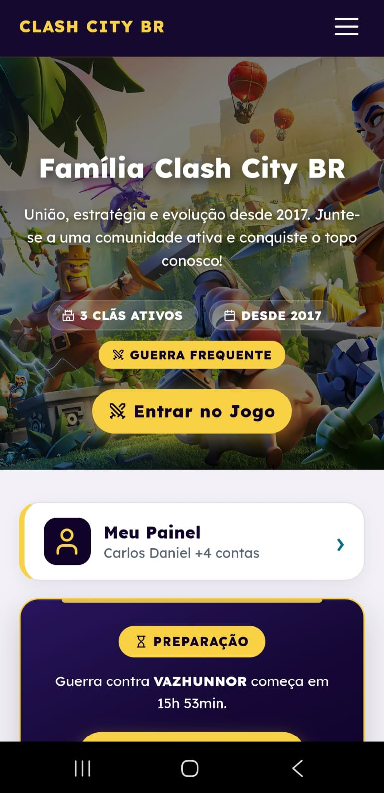
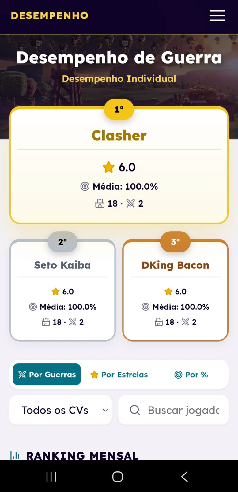
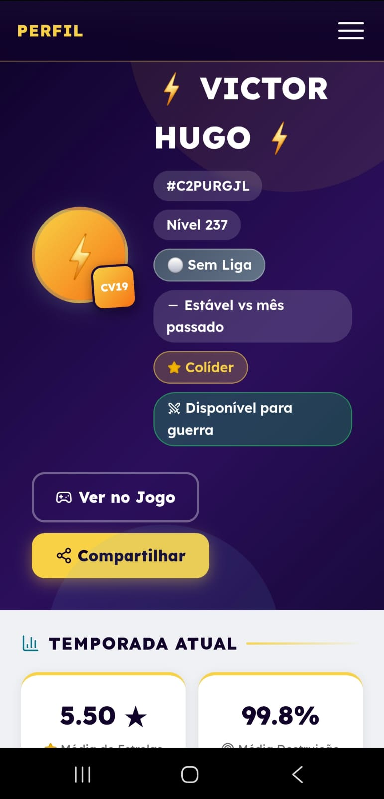
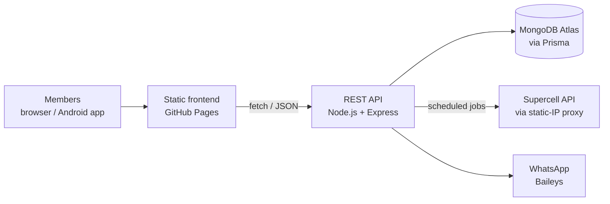

# Clash City BR

**A full-stack web app (installable as a PWA) that tracks war performance, rankings and league rosters for a real Clash of Clans community, used daily by its members.**

🌐 **Live site:** [clashcitybr.github.io](https://clashcitybr.github.io) · 📊 **Dashboard:** [clashcitybr.github.io/controle-cla](https://clashcitybr.github.io/controle-cla/) · 🏆 **League:** [clashcitybr.github.io/liga](https://clashcitybr.github.io/liga/)

<!-- Add 2–3 screenshots (or a short GIF) to a /docs folder and update the paths below -->
<p align="center">
  
  
  
</p>

---

## The problem

Clan leaders in Clash of Clans have no easy way to see who actually shows up and performs in clan wars. The game shows each war separately, so picking the best players for the monthly league (CWL) meant opening the game and checking players one by one.

Clash City BR solves this by syncing war data automatically from the official Supercell API, storing the history, and turning it into rankings, player profiles and league tools that any member can open on their phone.

## Features

- **Automatic war sync**: scheduled jobs fetch war results from the Supercell API and store every attack.
- **Monthly ranking**: players ranked by participation first, then average stars and destruction, so one lucky war doesn't put someone at the top.
- **Season history**: each month is archived, with a season selector and a Hall of Fame.
- **Player profiles**: live data from Supercell (heroes, equipment, trophies) plus performance charts per season (Chart.js).
- **League (CWL) area**: admin panel to build league rosters for the clan family and a partner clan, plus league war results shown on the site.
- **"My Dashboard"**: each member sees what needs their attention, their own performance and clan news.
- **WhatsApp alerts**: automated messages to the clan group (for example, low-performance war alerts).
- **Recommended attacks**: army compositions per Town Hall level, maintained by the community.
- **Installable app**: works as a PWA (install from the browser) and is also packaged as an Android app (Trusted Web Activity), currently in Google Play closed testing.
- **Mobile-first UI**: shared design system across all pages, SVG icons, responsive tables.

## Architecture



The project is split into four repositories:

| Repository | Role |
|---|---|
| [`clashcitybr.github.io`](https://github.com/clashcitybr/clashcitybr.github.io) | Home page, PWA manifest, Android app link (this repo) |
| [`controle-cla`](https://github.com/clashcitybr/controle-cla) | Main app: rankings, profiles, history, dashboard |
| [`liga`](https://github.com/clashcitybr/liga) | League (CWL) area |
| [`clash-city-br-api`](https://github.com/clashcitybr/clash-city-br-api) | Backend REST API |

## Tech stack

**Frontend:** HTML5, CSS3 (custom properties, Grid, Flexbox), vanilla JavaScript (ES6+), Chart.js, Service Worker / PWA
**Backend:** Node.js, Express, Prisma ORM, MongoDB Atlas, cron jobs, Baileys
**Integrations:** Supercell Clash of Clans API
**Infra:** GitHub Pages (frontend), Linux VM with PM2 (backend), Android TWA (Google Play closed testing)

## Running locally

**Frontend**
```bash
git clone https://github.com/clashcitybr/controle-cla.git
```
Set `BACKEND_URL` in `config.js` to your API address, then open `index.html` with a local server (for example, the VS Code Live Server extension).

**Backend**
```bash
git clone https://github.com/clashcitybr/clash-city-br-api.git
cd clash-city-br-api
npm install
cp .env.example .env      # fill in your own values
npx prisma generate
node server.js
```
You need a MongoDB Atlas database and a Clash of Clans API token from [developer.clashofclans.com](https://developer.clashofclans.com). On the first run, scan the QR code shown in the terminal to connect WhatsApp.

## What I learned

- **Debugging a third-party API:** a `403` error turned out to be a clan with a private war log, not an auth problem. I learned to read API error responses carefully before changing code.
- **Static IP and API keys:** the Supercell API locks each key to one IP address. My home IP kept changing, so I routed requests through a proxy with a fixed IP.
- **Data integrity:** I fixed a bug where war stars were being counted twice, and changed the monthly ranking so players who left the clan no longer appear with zero.
- **Protecting admin routes:** write operations in the league area go through an Express middleware that checks a secret key stored in environment variables.
- **Deploying and keeping a service online:** moved the backend from my PC to a Linux VM managed with PM2, so the site works 24/7.
- **Packaging for Android, and knowing when it's not needed:** I wrapped the site as a TWA and set up closed testing in the Google Play Console. In practice, most members just use the site or install the PWA, which taught me to check what users actually need before adding a new distribution channel.
- **Building from real use:** the best features came from using the app every day with the clan, not from a feature list.

## Author

Built by **Carlos Daniel**, Systems Analysis and Development student.
[GitHub](https://github.com/CarlosdaniDev) · [LinkedIn](https://www.linkedin.com/in/carlos-daniel-5b49b11b2)

**How I built it:** I used AI (Claude) as a pair programmer to move faster on implementation. I defined what to build, made the product and UX decisions, tested every feature with real users in the clan, debugged production issues, and I run the deployment and maintenance of the whole system.

---

### 🇧🇷 Para membros do clã

O Clash City BR é uma família de clãs de Clash of Clans ativa desde 24 de janeiro de 2017. Recrutamos jogadores **CV18+**: acesse [clashcitybr.github.io](https://clashcitybr.github.io) para conhecer os clãs e entrar.
